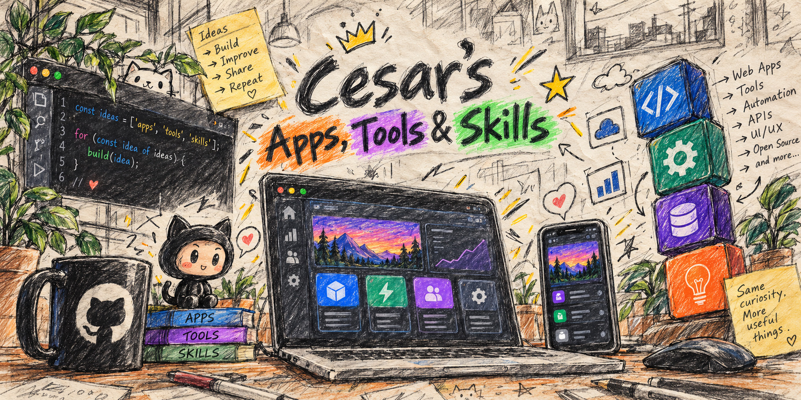

# Hey, I'm Cesar.

I make apps, useful tools, and skills for AI agents.
This is where I share what I'm building and what you can try.

## Start here

### [RED SNAPPER](https://github.com/cesarroger/red-snapper)

A free, open-source menu bar app for Mac that snaps windows into place with a keyboard shortcut or a drag to the screen edge, so you spend less time arranging them.

Status: version 1.0 released, MIT license, macOS 14 or newer. [Download for Mac](https://github.com/cesarroger/red-snapper/releases/latest)

## More things I've made

### [secret-broker](https://github.com/cesarroger/secret-broker)

A Claude Code mod that lets Claude run terminal commands that need an API key or token without ever seeing the value. You enter it in a private pop-up and approve the exact command.

Status: early, version 0.2.0. [View project](https://github.com/cesarroger/secret-broker)

## Feedback

Found a bug or have an idea? Open an issue on [RED SNAPPER](https://github.com/cesarroger/red-snapper/issues) or [secret-broker](https://github.com/cesarroger/secret-broker/issues).

Built with curiosity. Supervised by a sheepdog.
